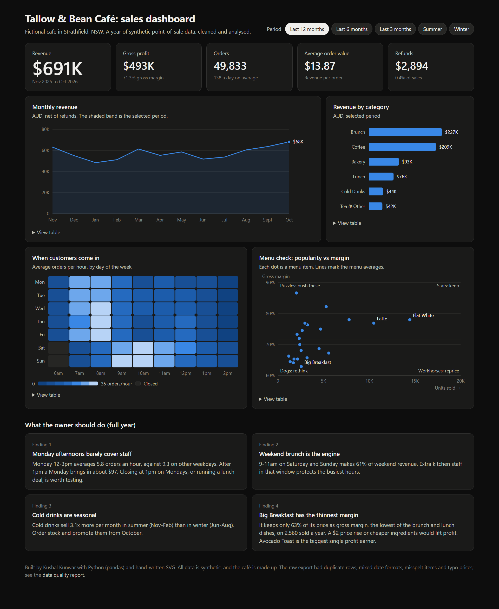

# Café sales dashboard

Turning a messy point-of-sale export into a dashboard a small business owner can act on.



**The scenario:** "Tallow & Bean" is a made-up café in Strathfield, NSW. The owner exports a year of sales from the till (Nov 2025 to Oct 2026, 82,272 rows) and wants to know where the money comes from and what to change. All the data is synthetic, generated with a fixed seed so it can be reproduced.

## What I did

1. **Cleaned the export** ([`src/clean.py`](src/clean.py)). The raw file had the problems real exports have:

   | Problem | Rows fixed |
   | --- | ---: |
   | Duplicate rows from an export glitch | 976 |
   | Dates in two formats (DD/MM/YYYY, then ISO after a system change) | 39,487 |
   | Misspelt or inconsistent item names ("Capuccino", "Avo Toast", "FLAT WHITE") | 3,827 |
   | Payment labels ("card", "CASH", "Apple Pay") | 12,571 |
   | Missing categories | 1,181 |
   | Blank prices | 482 |
   | Typo prices (decimal slipped, $50 for a $5 coffee) | 66 |
   | Refunds (kept, flagged) | 335 |

   The full log is in [`reports/data_quality.md`](reports/data_quality.md).

2. **Analysed it** ([`src/build_outputs.py`](src/build_outputs.py)): revenue and gross profit by month, category and item; busy hours by weekday; and a menu-engineering view of popularity against margin.

3. **Built an interactive dashboard** ([`dashboard/index.html`](dashboard/index.html)): a period filter, hover details, a table view for every chart, and light and dark modes. It's plain HTML and SVG with no libraries, so it opens anywhere.

4. **Exported an Excel workbook** (`excel/cafe_sales_summary.xlsx`) for owners who live in Excel. It has monthly and product summaries with live formulas, native Excel charts, and the clean data as a filterable table.

## What the owner should do

1. **Monday afternoons barely cover staff.** Monday 12-3pm averages 5.8 orders an hour, against 9.3 on other weekdays. Closing at 1pm on Mondays, or running a lunch deal, is worth testing.
2. **Weekend brunch is the engine.** 9-11am on Saturday and Sunday makes 61% of weekend revenue, so that's where extra kitchen staff pays off.
3. **Cold drinks are seasonal.** They sell 3.1x more per month in summer than in winter. Stock up and promote them from October.
4. **Big Breakfast has the thinnest margin** (63%) of the food dishes. A $2 price rise or cheaper ingredients would lift profit.

## Run it yourself

```bash
python -m venv .venv
.venv/Scripts/pip install pandas numpy openpyxl     # macOS/Linux: .venv/bin/pip
.venv/Scripts/python src/generate_data.py           # synthetic raw export
.venv/Scripts/python src/clean.py                   # clean data + quality report
.venv/Scripts/python src/build_outputs.py           # dashboard data, findings, Excel
.venv/Scripts/python -m http.server 8000            # then open http://localhost:8000/dashboard/
```

## Tools

Python (pandas, NumPy, openpyxl), HTML/SVG/JavaScript, Excel.

Built by Kushal Kunwar.
